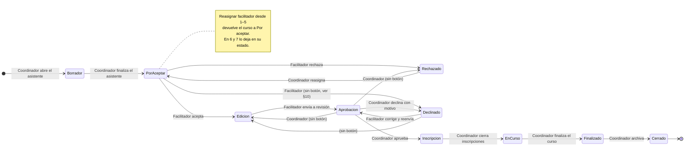
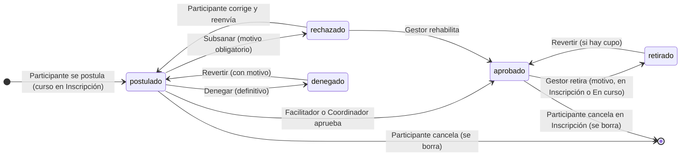
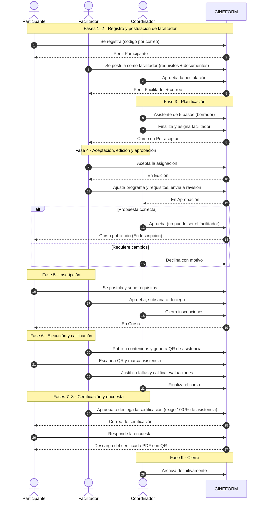

# Ciclo del curso

Este documento explica el recorrido completo de un curso en CINEFORM: desde que una persona se registra hasta que el curso se archiva. Es el eje que conecta los módulos. Cada fase dice qué ocurre, quién actúa, qué reglas aplica el sistema y qué clases lo implementan. El detalle método por método está en las fichas de [`modulos/`](modulos/).

> **Fuente de verdad.** Si este documento y el código no coinciden, manda el código. Los tres puntos que gobiernan el ciclo son:
> - `App\Enums\EstadoCurso`: estados y transiciones permitidas.
> - `Modules\Taller\Policies\CursoPolicy::cambiarEstado()`: quién puede hacer cada transición.
> - `Modules\Taller\Services\CondicionalEstadoCurso`: qué acciones ve cada actor en cada estado.

## Contenido

1. [Actores](#1-actores)
2. [Resumen de las 9 fases](#2-resumen-de-las-9-fases)
3. [Estados del curso](#3-estados-del-curso)
4. [Estados de la inscripción](#4-estados-de-la-inscripción)
5. [Recorrido completo (secuencia)](#5-recorrido-completo-secuencia)
6. [Las fases en detalle](#6-las-fases-en-detalle)
7. [Matrices de acciones y autorización](#7-matrices-de-acciones-y-autorización)
8. [Trazabilidad](#8-trazabilidad)
9. [Casos límite](#9-casos-límite)
10. [Inconsistencias conocidas](#10-inconsistencias-conocidas)

---

## 1. Actores

El sistema **no decide por nombre de perfil, sino por permisos**. Un usuario puede tener varios perfiles a la vez, y sus permisos son la **suma** de todos sus perfiles activos (ver [03-seguridad.md](03-seguridad.md)). Las policies del módulo Taller traducen esos permisos a tres papeles respecto de un curso concreto (`Policies/Traits/ResuelveRolesTaller.php`):

| Papel en el código | Cómo se decide | Perfil que normalmente lo tiene |
|---|---|---|
| **Gestor** (`esGestor`) | Tiene `manage_course` **y** `supervise_courses` | Coordinador, Administrator |
| **Facilitador del curso** (`esFacilitadorDe`) | Su `id_persona` es el `cursos.id_persona` del curso | Facilitador asignado |
| **Participante** | Tiene una inscripción en el curso | Participante |

Permisos del proceso `taller.cursos.index` por perfil (datos actuales de `security.profile_permissions`):

| Permiso (slug) | Admin | Coordinador | Facilitador | Participante |
|---|:-:|:-:|:-:|:-:|
| Ver catálogo (`view`) | ✓ | ✓ | ✓ | ✓ |
| Planificar cursos (`create_course`) | ✓ | ✓ | | |
| Gestionar cursos (`manage_course`) | ✓ | ✓ | | |
| Supervisar todos los cursos (`supervise_courses`) | ✓ | ✓ | | |
| Dictar curso (`edit_course`) | ✓ | ✓ | ✓ | |
| Editar curso finalizado (`edit_course_e`) | ✓ | ✓ | | |
| Aceptar/rechazar facilitación (`accept_course`) | ✓ | ✓ | ✓ | |
| Aprobar e iniciar inscripciones (`approve_course`) | ✓ | ✓ | | |
| Calificar participantes (`grade_course`) | ✓ | | ✓ | |
| Ver participantes (`view_participants`) | ✓ | ✓ | ✓ | |
| Gestionar asistencia (`manage_attendance`) | ✓ | ✓ | ✓ | |
| Cancelar inscripciones (`cancel_enrollment`) | ✓ | ✓ | | |
| Generar reporte de satisfacción (`export_satisfaction`) | ✓ | ✓ | | |
| Inscribirse (`enroll`) | ✓ | ✓ | | ✓ |
| Marcar asistencia propia (`mark_attendance`) | ✓ | ✓ | | ✓ |

Los permisos se pueden cambiar desde *Seguridad → Perfiles*. La tabla refleja el estado al 27/10/2026.

**Conflicto de interés.** Quien es el facilitador asignado a un curso **no** puede revisarlo, aprobarlo ni reasignarlo, aunque también sea coordinador. Lo garantiza `CursoPolicy::revisarComoCoordinacion()` (= gestor **y** no facilitador del curso). Tampoco puede asignarse a sí mismo como facilitador. La única excepción es el usuario raíz (id 1).

---

## 2. Resumen de las 9 fases

| # | Fase | Estados del curso | Actúa | Implementación principal |
|---|---|---|---|---|
| 1 | Registro | — | Persona (público) | `Registro/RegisterController` |
| 2 | Postulación de facilitador | — | Persona registrada → Gestor | `Taller/PostulacionFacilitadorController` |
| 3 | Planificación | Borrador (10) → Por aceptar (1) | Coordinador | `Taller/CrearCursoController`, `BorradorWizardService` |
| 4 | Aceptación, edición y aprobación | Por aceptar (1), Rechazado (2), Declinado (3), Edición (4), Aprobación (5) | Facilitador ↔ Coordinador | `CursoController::updateStatus`, `finalizarEdicion`, `reasignarFacilitador`; `EditarCursoController` |
| 5 | Publicación e inscripción | Inscripción (6) | Participante → Facilitador o Coordinador | `InscripcionController` |
| 6 | Ejecución y calificación | En curso (7) | Facilitador, Participante | `CursoController::contenido`, `AsistenciaController`, `CalificacionController` |
| 7 | Certificación | Finalizado (8) | Facilitador o Coordinador → Participante | `CertificacionPanelController`, `CertificadoController`, `CertificadoService` |
| 8 | Encuesta de satisfacción | Finalizado (8), Cerrado (9) | Participante → Coordinador | `SatisfaccionCursoController`, `SatisfaccionCursoService` |
| 9 | Cierre | Cerrado (9) | Coordinador | `CursoController::updateStatus` |

La calificación no es una fase aparte: ocurre **durante** la ejecución, sobre los contenidos marcados como evaluación.

---

## 3. Estados del curso

Los estados viven en la tabla `taller.estados_curso` y en el enum `App\Enums\EstadoCurso`, con el mismo id. Un curso **no guarda su estado en una columna**: cada cambio inserta una fila en `taller.curso_estado`, y el estado actual es la fila más reciente (`Curso::estado_actual`). Así el historial completo queda en la base de datos.

| Id | Enum | Etiqueta | Significado |
|---|---|---|---|
| 10 | `BORRADOR` | Borrador | Curso en construcción. *(Ver §10: la descripción en BD está desactualizada.)* |
| 1 | `POR_ACEPTAR` | Por Aceptar | Asignado a un facilitador que aún no responde. |
| 2 | `RECHAZADO` | Rechazado | El facilitador rechazó la asignación: el curso queda sin facilitador. |
| 3 | `DECLINADO` | Declinado | Coordinación devolvió la propuesta desde *Aprobación* con observaciones. |
| 4 | `EDICION` | En Edición | El facilitador adapta el programa a su forma de dictarlo. |
| 5 | `APROBACION` | En Aprobación | Coordinación revisa la propuesta. |
| 6 | `INSCRIPCION` | En Inscripción | Publicado: los participantes se postulan. |
| 7 | `EN_CURSO` | En Curso | Se dicta: contenido, asistencia y calificación. |
| 8 | `FINALIZADO` | Finalizado | Terminó el dictado: certificación y encuesta. |
| 9 | `CERRADO` | Cerrado | Archivado: solo se descargan certificados ya aprobados y se consulta. |

### Diagrama de estados

Las transiciones son exactamente las de `EstadoCurso::transicionesPermitidas()`. La etiqueta indica quién puede hacer cada una según `CursoPolicy::cambiarEstado()`.

Además de las flechas del diagrama:

- **Reasignación:** desde los estados 1, 2, 3, 4 y 5 el curso puede volver a *Por aceptar*. El enum lo permite como transición en todos ellos.
- **Vuelta a Borrador:** el enum la permite desde 1–5, pero **ningún flujo de la interfaz la usa**.
- **Transiciones al mismo estado:** 1→1, 4→4, 6→6 y 7→7 son válidas en el enum y existen para que reasignar o guardar no falle.

Todos los cambios pasan por **`CursoController::updateStatus()`**, incluido aceptar la asignación. Hay tres excepciones:
- al finalizar el asistente (`CrearCursoController::finalizar`);
- al enviar a revisión (`CursoController::finalizarEdicion`);
- al reasignar (`CursoController::reasignarFacilitador`).

`updateStatus()` aplica dos controles en orden y responde así:

| Control | Si falla |
|---|---|
| 1. ¿El usuario puede hacer este par (origen, destino)? (`authorize('cambiarEstado')`) | **403** |
| 2. ¿El enum permite el salto? (`puedeTransicionarA`) | **422** con el mensaje «El curso no puede pasar de "X" a "Y"» |

---

## 4. Estados de la inscripción

Una inscripción (`taller.inscripciones`) guarda su estado en la columna `estado`. Los estados están definidos como constantes en `Modules\Taller\Entities\Inscripcion`.

| Estado | Constante | Significado | ¿Ocupa cupo? |
|---|---|---|:-:|
| `postulado` | `ESTADO_POSTULADO` | Envió su postulación y los requisitos; espera revisión. | No |
| `aprobado` | `ESTADO_APROBADO` | Admitido. Es el único estado que cuenta como inscripción activa (`scopeActivas`). | **Sí** |
| `rechazado` | `ESTADO_RECHAZADO` | **Subsanar**: se devolvió con un motivo y el participante puede corregir y reenviar. | No |
| `denegado` | `ESTADO_DENEGADO` | Rechazo definitivo: el participante no puede volver a postularse. | No |
| `retirado` | `ESTADO_RETIRADO` | Un gestor lo retiró del curso ya admitido, con motivo. | No |

Reglas clave (`InscripcionController`):

- Solo se puede postular con el curso en **Inscripción (6)** y si quedan cupos (`cursos.cantidad_cupos`; `null` significa sin límite).
- **Subsanar vs. denegar:** *subsanar* deja corregir al participante; *denegar* y *retirar* son definitivos **para el participante**, pero quien gestiona puede deshacerlos con **Revertir** (decisión D6).
  - **Revertir** exige motivo y solo funciona con el curso en Inscripción o En curso.
  - Una denegación revertida vuelve a `postulado`, para revisarla de nuevo.
  - Un retiro revertido vuelve a `aprobado`, si hay cupo.
- Una inscripción **aprobada** no se puede subsanar: hay que retirarla.
- Cuando el participante cancela su propia inscripción, **la fila se borra** junto con los documentos que adjuntó. Solo puede hacerlo mientras el curso esté en Inscripción.

Quién puede hacer cada acción (`InscripcionPolicy`):

| Acción | Quién |
|---|---|
| Aprobar, subsanar, denegar, revertir una denegación | Gestor o facilitador del curso (`gestionar`) |
| Retirar, rehabilitar, revertir un retiro | Gestor con `cancel_enrollment` y alcance global (`rehabilitar`) |
| Corregir la postulación y cancelar la propia inscripción | El participante titular |

---

## 5. Recorrido completo (secuencia)

---

## 6. Las fases en detalle

### Fase 1 · Registro

- **Qué ocurre:** una persona crea su cuenta desde `/registro`. Recibe un código de verificación por correo y al terminar el sistema le asigna el perfil **Participante**.
- **Implementación:** `Modules\Registro\Http\Controllers\RegisterController`.
  - El código se envía con `Mail::send('registro::emails.send_code')`.
  - El alta crea el usuario en `security.users`, la persona en `comun.personas` y el perfil en `security.profiles_users`.
  - Al final se envía el correo `registro_exitoso`.
- **Detalle:** [modulos/registro.md](modulos/registro.md).

### Fase 2 · Postulación de facilitador

- **Qué ocurre:**
  - Un usuario registrado se postula como facilitador. Responde los requisitos configurados y adjunta documentos.
  - Un gestor revisa la postulación y la aprueba o la rechaza con motivo.
  - **Aprobarla asigna directamente el perfil Facilitador** (`Perfil::FACILITADOR`).
- **Estados** (`PostulacionFacilitador`): `pendiente` → `aprobada` | `rechazada`. Con una postulación pendiente no se puede abrir otra.
- **Reglas:**
  - Nadie resuelve su propia postulación (`impedirResolverPropiaPostulacion`).
  - Los requisitos se administran en *Administración → Requisitos Facilitador*.
- **Correos:** postulación recibida, aprobada y rechazada.
- **Detalle:** [modulos/taller/postulacion-facilitador.md](modulos/taller/postulacion-facilitador.md).

### Fase 3 · Planificación

- **Quién:** solo quien tiene `create_course` (Coordinador, Admin). **El facilitador no crea cursos.**
- **Qué ocurre:** un asistente de pasos (`/taller/crear-curso/…`) arma el curso:

  | Paso | Contenido |
  |---|---|
  | 1 | Identidad: nombre, nivel, actividad formativa, aspecto y foto |
  | 2 | Logística: fechas, modalidad, localidades, cupos y **facilitador** |
  | 3 | Temario |
  | 4 | Plantilla de certificado |
  | 5 | Requisitos y revisión |

  Mientras se completa, el avance se guarda como **borrador** en `taller.curso_borradores` (`BorradorWizardService`), así que se puede salir y retomarlo.
- **Al finalizar** (`CrearCursoController::finalizar`):
  1. Crea el curso en `taller.cursos`.
  2. Copia los requisitos.
  3. Registra el estado **Por aceptar (1)** y borra el borrador.
- **Código PROCINEC:** `CursoObserver` genera un código único con el formato `LAB-{actividad}{trimestre}{correlativo}{aspecto}{modalidad}{modalidadEspecial}-{año}`. Una vez emitidos certificados, el código no se regenera.
- **Facilitadores elegibles:** usuarios con el permiso `edit_course` (`Autorizacion::esElegibleFacilitador`). El coordinador no puede elegirse a sí mismo.
- **Limpieza:** el comando `taller:limpiar-wizards` purga las carpetas temporales del asistente (más de 24 h), los QR temporales (más de 1 h) y los borradores de más de 7 días. Se ejecuta a diario a medianoche desde el contenedor `scheduler` (ver [08-despliegue-y-mantenimiento.md](08-despliegue-y-mantenimiento.md)).
- **Detalle:** [modulos/taller/cursos-y-planificacion.md](modulos/taller/cursos-y-planificacion.md).

### Fase 4 · Aceptación, edición y aprobación

1. **Por aceptar (1):** el facilitador asignado ve *Aceptar asignación* y *Rechazar asignación*. Para responder necesita `accept_course`.
   - Si **acepta**, el curso pasa a **En edición (4)**.
   - Si **rechaza**, el curso pasa a **Rechazado (2)**. Queda **sin facilitador** (`id_persona = null`) y se guarda una observación con el motivo. Coordinación debe reasignarlo.
2. **En edición (4):** el facilitador edita el programa y los requisitos (`EditarCursoController`). Luego pulsa *Enviar a revisión*, que llama a `CursoController::finalizarEdicion`. Solo el facilitador asignado puede enviarlo.
3. **En aprobación (5):** coordinación revisa la propuesta.
   - *Aprobar propuesta* la lleva a **Inscripción (6)**. Requiere `approve_course` y no ser el facilitador.
   - *Declinar propuesta* la lleva a **Declinado (3)**, con un motivo que se guarda como observación.
   - Mientras tanto, el facilitador ve el aviso *En revisión*.
4. **Declinado (3):** el facilitador lee las observaciones (*Ver observaciones*), corrige el programa o los requisitos y pulsa *Enviar a revisión*. El curso vuelve a **En aprobación (5)**. Este ciclo se repite las veces que haga falta. Solo el facilitador asignado puede reenviarlo (prueba `ReenvioCursoDeclinadoTest`).
5. **Reasignar facilitador** (`CursoController::reasignarFacilitador`):
   - Solo un gestor que no sea el facilitador actual.
   - Permitido en los estados 1 a 7. Con el curso en 6 o 7 no se puede cambiar el facilitador desde la edición del curso, solo con esta acción.
   - En los estados 1–5 el curso vuelve a *Por aceptar* para que el nuevo facilitador acepte. En 6–7 se mantiene el estado para no interrumpir el curso.
   - Siempre se registra una observación automática.
- **Detalle:** [modulos/taller/cursos-y-planificacion.md](modulos/taller/cursos-y-planificacion.md).

### Fase 5 · Publicación e inscripción

- **Visibilidad:** el catálogo (`CursoController::index`) muestra los cursos **en Inscripción** que están al alcance geográfico de la persona (nacional o su localidad), más los cursos en los que ya está inscrita.
- **Postulación** (`InscripcionController::create` / `procesarInscripcion`):
  1. El participante responde los requisitos del curso (`taller.curso_requisitos`), con documentos opcionales. Las respuestas se guardan en `taller.inscripcion_respuestas`.
  2. Queda en `postulado`.
  3. Se bloquean las postulaciones duplicadas, salvo para corregir una postulación devuelta para subsanar.
- **Revisión:** el facilitador del curso o un gestor abre *Postulados y participantes*. Ve los documentos en vista previa y aprueba, subsana o deniega (ver §4). Al aprobar se comprueba el cupo.
- **Cierre de inscripciones:** coordinación pulsa *Cerrar inscripciones* y el curso pasa a **En curso (7)**. **Es manual:** no hay cambio automático por fecha.
- **Detalle:** [modulos/taller/inscripcion-y-ejecucion.md](modulos/taller/inscripcion-y-ejecucion.md).

### Fase 6 · Ejecución y calificación

- **Contenido:** el facilitador publica clases y evaluaciones (`taller.contenido_cursos`).
  - Ven el contenido el gestor, el facilitador del curso y los participantes **aprobados** (`CursoPolicy::verContenido`).
- **Asistencia** (`AsistenciaController`). Requiere `manage_attendance` y alcance sobre el curso.
  - **Por QR:** el facilitador genera un token con expiración en minutos (`generarToken`; tabla `taller.asistencia_tokens`). El participante escanea el QR, confirma y queda registrado (`mostrarConfirmacion` → `marcar`).
  - **Manual:** `marcarManual`. Una asistencia se puede **anular** y **restaurar**.
  - **Justificación de faltas** (`justificarFalta`, `quitarJustificacion`, tabla `taller.asistencia_justificaciones`). Una falta justificada **cuenta como asistida**.
  - **Consulta:** el consolidado por curso y la ficha individual. Coordinación también gestiona la asistencia en el estado 7 y la consulta en el 8.
- **Calificación** (`CalificacionController`, tabla `taller.calificaciones`):
  - Califica **solo el facilitador asignado** que tenga `grade_course` (`CursoPolicy::calificar`). El coordinador no califica.
  - Las notas se pueden poner y corregir hasta *Finalizado* inclusive; **solo *Cerrado* las bloquea** (decisión E5).
  - El promedio se muestra en el panel de certificación como referencia: **no es condición para certificar**. Es intencional: hoy los cursos son talleres y se certifican por asistencia. La nota se registra pensando en un uso posterior, cuando la oferta evolucione de cursos a una **academia** con exigencia académica (ver [09-deuda-tecnica.md](09-deuda-tecnica.md)).
- **Fin del dictado:** coordinación pulsa *Finalizar curso* y el curso pasa a **Finalizado (8)**. También es manual.
- **Detalle:** [modulos/taller/inscripcion-y-ejecucion.md](modulos/taller/inscripcion-y-ejecucion.md).

### Fase 7 · Certificación

- **Panel de certificación** (`CertificacionPanelController`). Disponible en los estados 8 y 9 para el gestor y para el facilitador del curso con `manage_attendance`. Muestra a cada participante aprobado con su asistencia, su promedio y el estado de su certificado.
- **Aprobar:**
  - Exige el **100 % de asistencia**, con cada falta justificada (`CumplimientoAsistencia::deInscripcion`, decisión D3). Si falta alguna, el sistema lo impide con el número de faltas sin justificar.
  - Al aprobar, guarda `certificado_aprobado`, quién aprobó y la fecha.
- **Denegar:** exige motivo (`certificado_motivo_denegacion`).
- **Correos:** `certificacion_aprobada` o `certificacion_rechazada`, con `Mail::queue`. Hoy la cola es síncrona, así que el correo se envía en el momento.
- **Plantilla:**
  - Cada curso puede tener su plantilla y su firma; si no, usa la plantilla global.
  - Solo un gestor la ajusta, en los estados 1 a 8 (`CondicionalEstadoCurso::puedeAjustarCertificado`).
  - Las imágenes se normalizan a A4 horizontal (`ImagenCertificadoService`).
- **Emisión:** `CertificadoController::descargar` genera el PDF con FPDF (`CertificadoService`). Incluye un QR (`BaconQrGenerator`) que apunta a la verificación pública.
- **Verificación pública:** `/taller/certificados/verificar/{codigo}`, sin iniciar sesión.
- **Detalle:** [modulos/taller/certificacion.md](modulos/taller/certificacion.md).

### Fase 8 · Encuesta de satisfacción

- **Cuándo:** con el curso en *Finalizado* o *Cerrado* (`SatisfaccionCursoService::cursoPermiteEncuesta`).
- **Obligatoria para descargar:** si el participante tiene la certificación aprobada y no ha respondido, el botón *Obtener certificado* se reemplaza por *Responder encuesta*. Se responde una sola vez por inscripción (`taller.resenas_satisfaccion`).
- **Qué evalúa:**
  - el contenido;
  - el desempeño pedagógico del facilitador;
  - el material de apoyo;
  - la organización.
- **Resultados:** los consultan el gestor y el facilitador del curso (`verSatisfaccion`). El **reporte** en Excel solo lo genera quien además tiene `export_satisfaction`; el facilitador solo consulta (decisión D2).
- **Detalle:** [modulos/taller/encuesta-y-estadisticas.md](modulos/taller/encuesta-y-estadisticas.md).

### Fase 9 · Cierre

- **Qué ocurre:** coordinación pulsa *Archivar definitivamente* y el curso pasa a **Cerrado (9)**, que es irreversible: el enum no permite ninguna salida.
- **Qué queda bloqueado:**
  - las calificaciones;
  - la gestión de asistencia;
  - el ajuste de la plantilla del certificado;
  - las acciones sobre inscripciones.
- **Qué sigue disponible:**
  - descargar los certificados ya aprobados;
  - responder la encuesta, si estaba pendiente;
  - consultar el panel de certificación y los resultados;
  - el aviso de archivo, visible para cualquiera.
- **Plazo:** no hay plazo ni cierre automático. Lo decide coordinación.

---

## 7. Matrices de acciones y autorización

### Acciones visibles por estado

Fuente: `CondicionalEstadoCurso::MAPA_CAPACIDADES` más las reglas añadidas en `obtenerCapacidades()`. El panel del curso (`a/partials/curso-actions/`) dibuja un botón por cada capacidad. Hay tres bloques: *Coordinación*, *Como facilitador* y el del participante.

| Estado | Gestor | Facilitador del curso | Participante |
|---|---|---|---|
| 1 Por aceptar | Reasignar, ajustar certificado | Aceptar o rechazar asignación | — |
| 2 Rechazado | Reasignar, ver motivo | Ver motivo | — |
| 3 Declinado | Reasignar, ver motivo, ajustar certificado | Editar, enviar a revisión, ver motivo | — |
| 4 En edición | Reasignar, ajustar certificado | Editar programa y requisitos, enviar a revisión | — |
| 5 En aprobación | Aprobar, declinar, reasignar, ajustar certificado | Aviso *en revisión* | — |
| 6 Inscripción | Cerrar inscripciones, reasignar, ver participantes, ajustar certificado | Ver participantes | Inscribirse o cancelar, ver contenido |
| 7 En curso | Finalizar curso, gestionar asistencia, reasignar, ver participantes, ajustar certificado | Gestionar asistencia, ver participantes | Ver contenido, marcar asistencia |
| 8 Finalizado | Archivar, consultar asistencia, panel de certificación, resultados de encuesta, ajustar certificado | Consultar asistencia, panel de certificación, resultados de encuesta | Ver contenido, encuesta y certificado |
| 9 Cerrado | Panel de certificación, resultados de encuesta | Panel de certificación, resultados de encuesta | Certificado, aviso de archivo |
Siempre, en cualquier estado, el gestor y el facilitador del curso pueden **ver el contenido**. Si el usuario es coordinador y a la vez facilitador del curso, el bloque *Coordinación* oculta las acciones de revisión y muestra el aviso: «Eres el facilitador de este curso: revisarlo, aprobarlo o reasignarlo corresponde a otra persona de coordinación».

### Autorización por transición

Fuente: `CursoPolicy::cambiarEstado()`. Se combina con el control del enum (§3).

| Destino | Desde | Quién puede |
|---|---|---|
| Edición (4) | Por aceptar | Facilitador del curso con `accept_course`, o gestor |
| Edición (4) | Aprobación | Gestor que no sea el facilitador |
| Edición (4) | otro | Gestor o facilitador del curso |
| Declinado (3) | Aprobación | Gestor que no sea el facilitador |
| Declinado (3) | Por aceptar | Facilitador del curso con `accept_course` |
| Aprobación (5) | — | Gestor o facilitador del curso |
| Inscripción (6) | — | Quien tenga `approve_course` y no sea el facilitador (`aprobar`) |
| Rechazado (2) | cualquiera | Gestor que no sea el facilitador; desde Por aceptar, también el facilitador con `accept_course` |
| En curso, Finalizado, Cerrado, Por aceptar, Borrador | — | Gestor |

Cuando el facilitador rechaza o declina desde *Por aceptar*, el sistema además **le quita la asignación** al curso.

---

## 8. Trazabilidad

| Qué | Dónde queda |
|---|---|
| Cada cambio de estado del curso | `taller.curso_estado` (`id_curso`, `id_estado`, `motivo`, fecha), con `Curso::agregarEstado()` |
| Motivos de rechazo, declinación y reasignación | `taller.observaciones_curso`, visibles con *Ver observaciones* |
| Decisiones sobre inscripciones | `inscripciones.estado`, `motivo_estado`, `rechazada_por`, `fecha_rechazo` |
| Decisiones de certificación | `inscripciones.certificado_aprobado`, `certificado_aprobado_por`, `certificado_fecha_aprobacion`, `certificado_motivo_denegacion` |
| Acciones sensibles (revertir, cambios de perfil…) | `security.auditoria` (`App\Services\Security\Auditoria`), con el antes y el después |

---

## 9. Casos límite

| Situación | Comportamiento |
|---|---|
| Cupos llenos | No se puede postular ni aprobar a más participantes. Revertir un retiro también exige cupo. `cantidad_cupos = null` significa sin límite. |
| El facilitador rechaza la asignación | El curso queda en *Rechazado* y sin facilitador. Solo coordinación puede reasignarlo. |
| El facilitador deja de dictar con el curso en marcha | Coordinación lo reasigna en Inscripción o En curso sin cambiar el estado. Queda una observación de «incumplimiento o cambio de asignación». |
| El coordinador también es el facilitador del curso | No puede aprobarlo, declinarlo ni reasignarlo: necesita a otra persona de coordinación. |
| Un participante retirado quiere volver | No puede postularse. Un gestor puede revertir el retiro si hay cupo. |
| Un participante tiene faltas | No se le puede aprobar la certificación hasta que el facilitador justifique cada falta. |
| El participante no respondió la encuesta | No puede descargar el certificado aunque esté aprobado. |
| Hay que corregir una nota | Se puede hasta *Finalizado*; en *Cerrado* ya no. |
| Coordinación declina la propuesta | El facilitador corrige y la reenvía a revisión, tantas veces como haga falta. |
| Una persona registrada sin datos personales | Las acciones que dependen de `personalData` responden «complete su perfil primero». |

---

## 10. Inconsistencias conocidas

Se registran también en [09-deuda-tecnica.md](09-deuda-tecnica.md).

**Pendientes**

1. **El estado *Borrador* está descrito al revés.** En `taller.estados_curso` dice «Curso en proceso de creación por el facilitador», pero quien crea cursos es coordinación (`create_course`). Además, el borrador real vive en `taller.curso_borradores`, no como estado del curso.
2. **Transiciones permitidas sin interfaz.** Existen en la policy y en el enum, pero ningún botón las usa:
   - *Por aceptar → Declinado*;
   - *Declinado → Edición*;
   - *Aprobación → Edición*;
   - *Aprobación → Rechazado*;
   - la vuelta a *Borrador*.

   O se les da uso o se eliminan.
3. **Cambios de fase manuales.** *Inscripción → En curso* y *En curso → Finalizado* dependen de que coordinación pulse el botón; las fechas del curso no los disparan.
4. **Perfil fijo en el registro.** `RegisterController` asigna el perfil con el número `3` escrito en el código, en lugar de usar la constante `Perfil::PARTICIPANTE`.

**Resueltas (27/10/2026)**

- ~~«Enviar a revisión» fallaba en *Declinado*~~: el botón aparecía, pero el enum no permitía *Declinado → Aprobación*. Se añadió esa transición a `EstadoCurso::DECLINADO`, con la prueba `ReenvioCursoDeclinadoTest`.
- ~~El programador de tareas no corría~~: se añadió el servicio `scheduler` (`php artisan schedule:work`, usuario `www-data`) a `docker-compose.yml`. En su primera ejecución, `taller:limpiar-wizards` eliminó 36 temporales acumulados.
- *La nota no influye en la certificación*: **es intencional**. Queda reservada para cuando la oferta pase de cursos a una academia.
